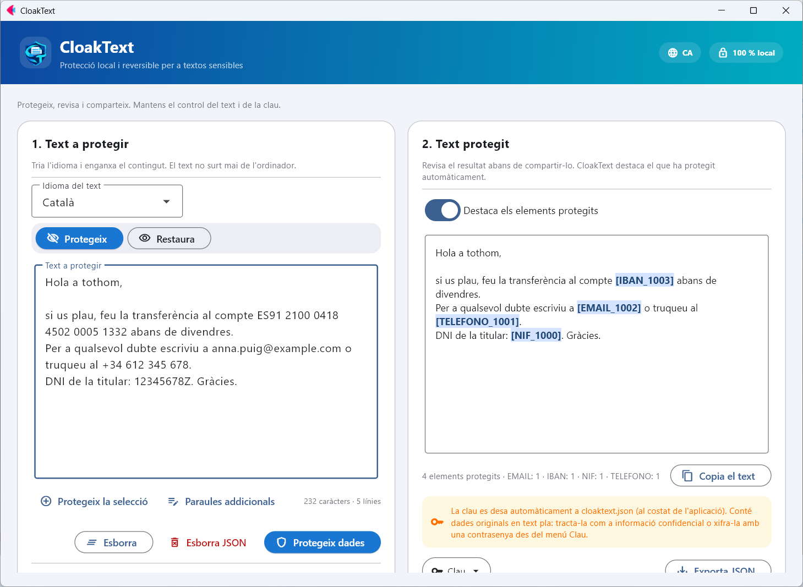
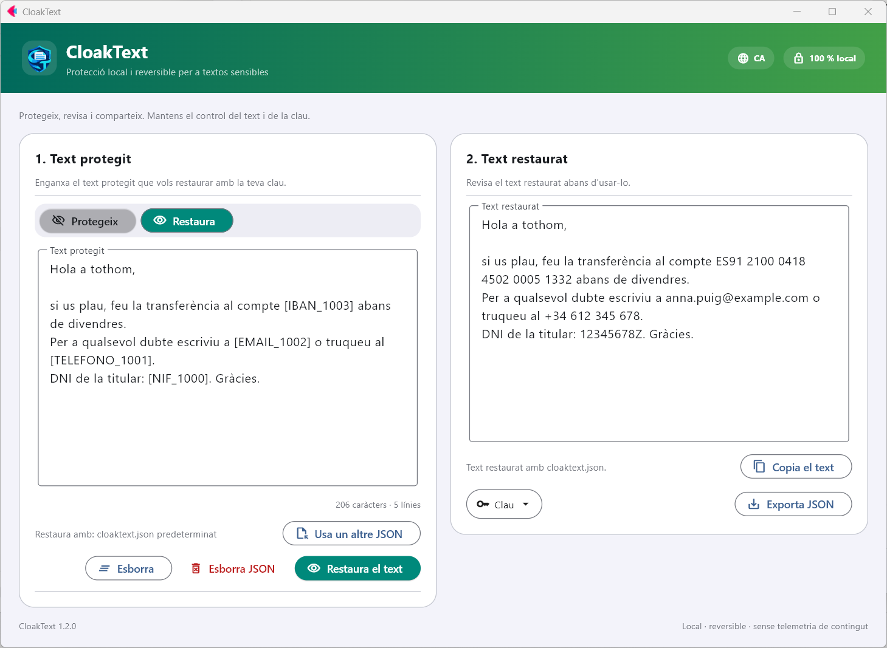

<p align="center">
  
</p>

<h1 align="center">CloakText</h1>

<p align="center">
  Protecció local i reversible per a textos sensibles. Sense connexió i de codi obert.<br>
  <a href="README.md">English</a> · <a href="README.es.md">Español</a> · <a href="README.fr.md">Français</a> · <a href="README.de.md">Deutsch</a> · <a href="README.it.md">Italiano</a> · <a href="README.pt.md">Português</a> · <b>Català</b>
</p>

<p align="center">
  <a href="https://github.com/nmc03/cloaktext/actions/workflows/ci.yml"></a>
  <a href="https://github.com/nmc03/cloaktext/releases/latest"></a>
  
  
  <a href="LICENSE"></a>
</p>

<p align="center">
  
</p>

CloakText substitueix les dades sensibles d'un text per marcadors reversibles com `[EMAIL_1001]` o `[PERSONA_1000]`, de manera que pots enganxar el text en un xat, un tiquet o un assistent d'IA sense exposar els originals. Quan necessitis els valors reals, els restaures amb la teva clau local.

Tot s'executa al teu equip. El text no s'envia a cap API ni servidor.

> [!IMPORTANT]
> La detecció automàtica pot deixar passar dades sensibles. **Revisa sempre el resultat abans de compartir-lo.** CloakText redueix l'exposició accidental; no és una garantia d'anonimització.

## Funcions

- **Protecció reversible**: marcadors que pots restaurar amb una clau local.
- **Revisió abans de compartir**: el que està protegit es ressalta al resultat.
- **Paraules addicionals**: afegeix noms de projectes, clients o sobrenoms que sempre han de quedar protegits, o selecciona text i prem *Protegeix la selecció*.
- **Clau xifrada (opcional)**: protegeix `cloaktext.json` amb una contrasenya (AES-256-GCM).
- **Neteja de la clau**: elimina les entrades més antigues de N dies des del menú *Clau*.
- **Interfície en 7 idiomes** (català, castellà, francès, alemany, italià, portuguès i anglès), segons l'idioma de Windows i canviable des de la capçalera.
- **Funciona sense connexió** i guarda les seves dades al costat de l'aplicació (o al teu perfil d'usuari si aquesta carpeta és de només lectura).

## Com funciona

1. **Protegir.** Enganxa un text, tria'n l'idioma i prem *Protegeix dades*. Els correus electrònics, els IBAN, els telèfons, els documents d'identitat, els noms, els llocs i les organitzacions se substitueixen per marcadors.
2. **Compartir.** Copia el text protegit on el necessitis.
3. **Restaurar.** Enganxa de nou el text protegit (o ja processat) i prem *Restaura el text*. Els marcadors tornen a ser els valors originals.

La correspondència entre marcadors i originals es desa a `cloaktext.json`, al costat de l'aplicació (o a `%LOCALAPPDATA%\CloakText` si aquesta carpeta no permet escriure-hi). Un mateix valor rep sempre el mateix marcador, de manera que el text protegit conserva el seu sentit.

> Els noms de tipus dels marcadors (`PERSONA`, `TELEFONO`, `NIF`…) es mantenen en castellà en tots els idiomes de la interfície perquè les claus de qualsevol versió continuïn sent compatibles.

<p align="center">
  
</p>

## Què detecta

CloakText combina regles per a dades estructurades amb reconeixement d'entitats de [spaCy](https://spacy.io/).

| Tipus | Exemples | Detector |
| --- | --- | --- |
| Correu electrònic, IPv4, IBAN | `ana@example.com`, `192.168.10.4`, `ES91 2100 …` | regles (IBAN amb MOD-97 i longitud per país) |
| Telèfons | `+34 612 345 678`, `91 123 45 67` | regles, segons l'idioma |
| DNI/NIE, passaports, identificadors fiscals, dates de naixement | DNI, NIE, SSN, NINO, NIR, Codice Fiscale… | regles, segons l'idioma |
| Persones, llocs, organitzacions | noms, ciutats, empreses | model d'idioma de spaCy |
| Les teves pròpies paraules | noms de projectes, clients, sobrenoms | coincidència exacta que indiques (*Paraules addicionals*) |

Idiomes: castellà, anglès, francès, alemany, italià, portuguès i català.

## Descàrrega per a Windows

Les versions estables es publiquen a [GitHub Releases](https://github.com/nmc03/cloaktext/releases). Descarrega `CloakText-<versió>-windows-x64.zip`, descomprimeix la carpeta **completa** i executa `CloakText.exe`. És una distribució portable `onedir`: l'executable ha de quedar al costat de la resta de la seva carpeta, i aquesta carpeta ha de tenir permís d'escriptura perquè hi desa la clau i els paquets d'idioma.

### Verificar la descàrrega

```powershell
Get-FileHash .\CloakText-1.2.0-windows-x64.zip -Algorithm SHA256
Get-Content .\SHA256SUMS.txt
```

Els hashes han de coincidir. L'executable **no està signat digitalment** (un certificat costa diners i això és un projecte personal), de manera que Windows pot mostrar «Editor desconegut» o un avís de SmartScreen (*Més informació → Executa de totes formes*). En lloc d'una signatura, cada versió inclou dues comprovacions que pots fer tu mateix:

1. el SHA-256 de dalt;
2. una atestació de procedència que demostra que el ZIP l'ha generat el workflow de GitHub Actions d'aquest repositori a partir d'un commit concret:

```powershell
gh attestation verify .\CloakText-1.2.0-windows-x64.zip --repo nmc03/cloaktext
```

També pots compilar-lo tu mateix des del codi font (consulta [docs/BUILDING.md](docs/BUILDING.md)).

## Primer ús: paquets d'idioma

El paquet base no inclou models lingüístics de tercers. La primera vegada que uses un idioma, CloakText mostra el nom del paquet, la seva mida (uns 400–575 MB) i la seva llicència. Només si l'acceptes, el descarrega dels releases oficials de [`explosion/spacy-models`](https://github.com/explosion/spacy-models), verifica un SHA-256 fixat al codi i l'instal·la a `CloakText\models`. Després, aquest idioma funciona sense connexió.

Cada protecció necessita el paquet de l'idioma del text: el model d'idioma s'executa juntament amb els detectors per regles (correus electrònics, IBAN, telèfons, documents…). Si falta, CloakText ofereix preparar-lo abans.

## Protegir la clau amb una contrasenya

Obre el menú **Clau** → *Protegeix la clau amb una contrasenya…*. Des d'aquest moment la clau es desa xifrada (AES-256-GCM, clau derivada amb scrypt) i CloakText demana la contrasenya en arrencar. Les còpies exportades també queden xifrades.

> [!WARNING]
> No hi ha recuperació de contrasenya. Si l'oblides, els textos ja protegits no es podran restaurar.

## Privacitat i seguretat en resum

- El text es processa en local i mai es puja.
- Sense compte ni telemetria. L'únic accés a la xarxa és la descàrrega del paquet d'idioma que aprovis.
- `cloaktext.json` conté les teves **dades originals en text pla**. Tracta'l com el document original i no el publiquis ni el sincronitzis sense xifrar.

Detalls a [PRIVACY.md](PRIVACY.md). Per notificar una vulnerabilitat, consulta [SECURITY.md](SECURITY.md).

## Executar des del codi font

Requereix Python 3.11–3.14 (es recomana 3.12).

```powershell
py -3.12 -m venv .venv
.\.venv\Scripts\Activate.ps1
python -m pip install -r requirements-dev.txt
python main.py
```

```bash
python3 -m venv .venv && source .venv/bin/activate
python -m pip install -r requirements-dev.txt
python main.py
```

## Desenvolupament

```bash
python -m pytest
python -m compileall -q main.py local_engine.py language_packs.py key_store.py i18n.py branding.py version.py
python -m pip check
```

```text
main.py             Interfície d'usuari en Flet
i18n.py + locales/  Textos de la interfície (7 idiomes)
local_engine.py     Motor de detecció i protecció reversible
language_packs.py   Descàrrega, verificació i instal·lació dels paquets d'idioma
key_store.py        Persistència atòmica de la clau de restauració
build.py            Compilació portable per a Windows
scripts/            Eines per a desenvolupadors (captures del README)
tests/              Proves automatitzades
```

Compilar l'executable de Windows es descriu a [docs/BUILDING.md](docs/BUILDING.md). Per contribuir, consulta [CONTRIBUTING.md](CONTRIBUTING.md); l'historial és a [CHANGELOG.md](CHANGELOG.md). Les versions segueixen SemVer.

## Llicència

El codi original de CloakText es publica sota la [llicència MIT](LICENSE). Flet, spaCy i els paquets d'idioma opcionals mantenen les seves pròpies llicències; consulta [THIRD_PARTY_NOTICES.md](THIRD_PARTY_NOTICES.md). Alguns paquets d'idioma tenen llicències més restrictives que la MIT (per exemple, no comercials o GPL); per això es descarreguen sota demanda i no s'inclouen al ZIP.

Copyright © 2026 Nahúm ([@nmc03](https://github.com/nmc03)).
