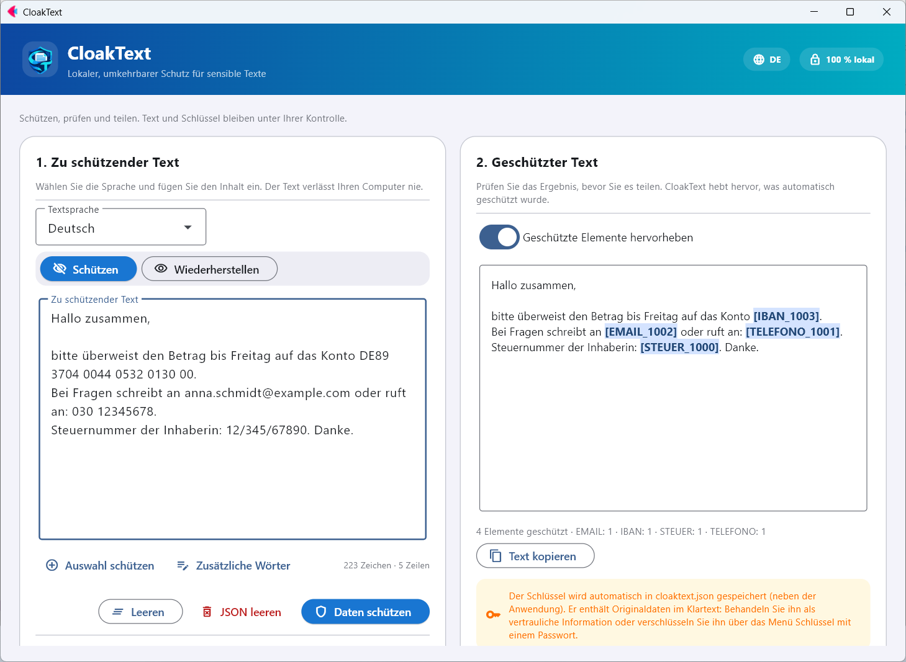
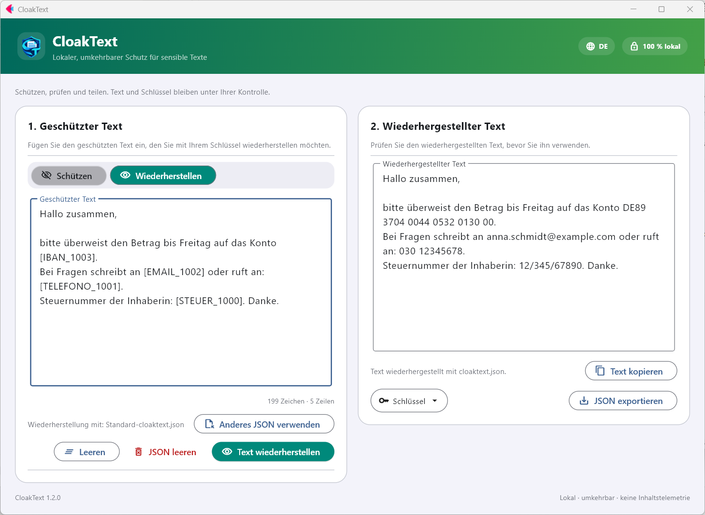

<p align="center">
  
</p>

<h1 align="center">CloakText</h1>

<p align="center">
  Lokaler, umkehrbarer Schutz für sensible Texte. Offline und Open Source.<br>
  <a href="README.md">English</a> · <a href="README.es.md">Español</a> · <a href="README.fr.md">Français</a> · <b>Deutsch</b> · <a href="README.it.md">Italiano</a> · <a href="README.pt.md">Português</a> · <a href="README.ca.md">Català</a>
</p>

<p align="center">
  <a href="https://github.com/nmc03/cloaktext/actions/workflows/ci.yml"></a>
  <a href="https://github.com/nmc03/cloaktext/releases/latest"></a>
  
  
  <a href="LICENSE"></a>
</p>

<p align="center">
  
</p>

CloakText ersetzt sensible Daten in einem Text durch umkehrbare Platzhalter wie `[EMAIL_1001]` oder `[PERSONA_1000]`, sodass Sie den Text in einen Chat, ein Ticket oder einen KI-Assistenten einfügen können, ohne die Originale preiszugeben. Wenn Sie die echten Werte brauchen, stellen Sie sie mit Ihrem lokalen Schlüssel wieder her.

Alles läuft auf Ihrem Computer. Der Text wird nie an eine API oder einen Server gesendet.

> [!IMPORTANT]
> Die automatische Erkennung kann sensible Daten übersehen. **Prüfen Sie das Ergebnis immer, bevor Sie es teilen.** CloakText verringert die versehentliche Offenlegung; es ist keine Garantie für Anonymisierung.

## Funktionen

- **Umkehrbarer Schutz**: Platzhalter, die Sie mit einem lokalen Schlüssel wiederherstellen können.
- **Prüfung vor dem Teilen**: Geschützte Elemente werden im Ergebnis hervorgehoben.
- **Zusätzliche Wörter**: Fügen Sie Projektnamen, Kunden oder Spitznamen hinzu, die immer geschützt werden sollen, oder markieren Sie Text und klicken Sie auf *Auswahl schützen*.
- **Verschlüsselter Schlüssel (optional)**: Schützen Sie `cloaktext.json` mit einem Passwort (AES-256-GCM).
- **Schlüsselpflege**: Löschen Sie Einträge, die älter als N Tage sind, über das Menü *Schlüssel*.
- **Oberfläche in 7 Sprachen** (Englisch, Spanisch, Französisch, Deutsch, Italienisch, Portugiesisch, Katalanisch), richtet sich nach Ihrer Windows-Sprache und lässt sich in der Kopfzeile umschalten.
- **Funktioniert offline** und speichert seine Daten neben der Anwendung (oder in Ihrem Benutzerprofil, falls dieser Ordner schreibgeschützt ist).

## So funktioniert es

1. **Schützen.** Fügen Sie einen Text ein, wählen Sie seine Sprache und klicken Sie auf *Daten schützen*. E-Mail-Adressen, IBANs, Telefonnummern, Ausweisnummern, Namen, Orte und Organisationen werden durch Platzhalter ersetzt.
2. **Teilen.** Kopieren Sie den geschützten Text, wohin Sie ihn brauchen.
3. **Wiederherstellen.** Fügen Sie den geschützten (oder bereits verarbeiteten) Text wieder ein und klicken Sie auf *Text wiederherstellen*. Die Platzhalter werden wieder zu den Originalwerten.

Die Zuordnung zwischen Platzhaltern und Originalen wird in `cloaktext.json` gespeichert, neben der Anwendung (oder in `%LOCALAPPDATA%\CloakText`, falls der Anwendungsordner nicht beschreibbar ist). Derselbe Wert erhält immer denselben Platzhalter, sodass der geschützte Text seine Bedeutung behält.

> Die Typnamen der Platzhalter (`PERSONA`, `TELEFONO`, `NIF`…) bleiben in allen Sprachen der Oberfläche auf Spanisch, damit die Schlüssel jeder Version kompatibel bleiben.

<p align="center">
  
</p>

## Was erkannt wird

CloakText kombiniert regelbasierte Erkennung für strukturierte Daten mit der Erkennung benannter Entitäten von [spaCy](https://spacy.io/).

| Art | Beispiele | Erkennung |
| --- | --- | --- |
| E-Mail, IPv4, IBAN | `ana@example.com`, `192.168.10.4`, `ES91 2100 …` | Regeln (IBAN mit MOD-97 und länderspezifischer Länge) |
| Telefonnummern | `+34 612 345 678`, `91 123 45 67` | Regeln, je nach Sprache |
| Ausweisnummern, Pässe, Steuernummern, Geburtsdaten | DNI/NIE, SSN, NINO, NIR, Codice Fiscale… | Regeln, je nach Sprache |
| Personen, Orte, Organisationen | Namen, Städte, Firmen | spaCy-Sprachmodell |
| Eigene Wörter | Projektnamen, Kunden, Spitznamen | genaue Übereinstimmung, die Sie angeben (*Zusätzliche Wörter*) |

Sprachen: Spanisch, Englisch, Französisch, Deutsch, Italienisch, Portugiesisch und Katalanisch.

## Download für Windows

Stabile Versionen gibt es auf [GitHub Releases](https://github.com/nmc03/cloaktext/releases). Laden Sie `CloakText-<version>-windows-x64.zip` herunter, entpacken Sie den **gesamten** Ordner und starten Sie `CloakText.exe`. Es ist ein portables `onedir`-Paket: Die ausführbare Datei muss neben dem Rest ihres Ordners bleiben. Der Ordner muss beschreibbar sein, da dort die Schlüsseldatei und die Sprachpakete gespeichert werden.

### Download prüfen

```powershell
Get-FileHash .\CloakText-1.2.0-windows-x64.zip -Algorithm SHA256
Get-Content .\SHA256SUMS.txt
```

Die Hashes müssen übereinstimmen. Die ausführbare Datei ist **nicht code-signiert** (ein Zertifikat kostet Geld und das hier ist ein Hobbyprojekt). Windows kann daher „Unbekannter Herausgeber“ oder eine SmartScreen-Warnung anzeigen (*Weitere Informationen → Trotzdem ausführen*). Statt einer Signatur enthält jede Version zwei Prüfungen, die Sie selbst durchführen können:

1. den SHA-256-Wert von oben;
2. eine Herkunftsbescheinigung (Build-Provenance-Attestation), die belegt, dass die ZIP-Datei vom GitHub-Actions-Workflow dieses Repositorys aus einem bestimmten Commit erstellt wurde:

```powershell
gh attestation verify .\CloakText-1.2.0-windows-x64.zip --repo nmc03/cloaktext
```

Sie können es auch selbst aus dem Quellcode bauen (siehe [docs/BUILDING.md](docs/BUILDING.md)).

## Erste Verwendung: Sprachpakete

Das Basispaket enthält keine Sprachmodelle von Drittanbietern. Beim ersten Gebrauch einer Sprache zeigt CloakText den Namen des Pakets, seine Größe (etwa 400–575 MB) und seine Lizenz an. Nur wenn Sie zustimmen, wird es von den offiziellen Releases von [`explosion/spacy-models`](https://github.com/explosion/spacy-models) heruntergeladen, gegen einen im Code festgelegten SHA-256-Wert geprüft und in `CloakText\models` installiert. Danach funktioniert diese Sprache offline.

Jeder Schutzvorgang benötigt das Sprachpaket der Textsprache: Das Sprachmodell läuft zusammen mit den regelbasierten Erkennern (E-Mails, IBANs, Telefonnummern, Ausweisnummern…). Fehlt es, bietet CloakText an, es zuerst vorzubereiten.

## Schlüssel mit Passwort schützen

Öffnen Sie das Menü **Schlüssel** → *Schlüssel mit Passwort schützen…*. Danach wird der Schlüssel verschlüsselt gespeichert (AES-256-GCM, Schlüsselableitung mit scrypt), und CloakText fragt beim Start nach dem Passwort. Auch exportierte Kopien bleiben verschlüsselt.

> [!WARNING]
> Es gibt keine Passwort-Wiederherstellung. Wenn Sie es vergessen, können bereits geschützte Texte nicht wiederhergestellt werden.

## Datenschutz und Sicherheit in Kürze

- Der Text wird lokal verarbeitet und nie hochgeladen.
- Kein Konto, keine Telemetrie. Der einzige Netzzugriff ist der Download des von Ihnen genehmigten Sprachpakets.
- `cloaktext.json` enthält Ihre **Originaldaten im Klartext**. Behandeln Sie sie wie das Originaldokument und veröffentlichen oder synchronisieren Sie sie niemals unverschlüsselt.

Details in [PRIVACY.md](PRIVACY.md). Um eine Sicherheitslücke zu melden, siehe [SECURITY.md](SECURITY.md).

## Aus dem Quellcode ausführen

Erfordert Python 3.11–3.14 (3.12 empfohlen).

```powershell
py -3.12 -m venv .venv
.\.venv\Scripts\Activate.ps1
python -m pip install -r requirements-dev.txt
python main.py
```

```bash
python3 -m venv .venv && source .venv/bin/activate
python -m pip install -r requirements-dev.txt
python main.py
```

## Entwicklung

```bash
python -m pytest
python -m compileall -q main.py local_engine.py language_packs.py key_store.py i18n.py branding.py version.py
python -m pip check
```

```text
main.py             Flet-Benutzeroberfläche
i18n.py + locales/  Oberflächentexte (7 Sprachen)
local_engine.py     Erkennung und umkehrbarer Schutz
language_packs.py   Download, Prüfung und Installation der Sprachpakete
key_store.py        Atomares Speichern des Wiederherstellungsschlüssels
build.py            Portabler Windows-Build
scripts/            Entwicklerwerkzeuge (README-Screenshots)
tests/              Automatisierte Tests
```

Den Windows-Build beschreibt [docs/BUILDING.md](docs/BUILDING.md). Zum Mitwirken siehe [CONTRIBUTING.md](CONTRIBUTING.md) und den Verlauf in [CHANGELOG.md](CHANGELOG.md). Die Versionen folgen Semantic Versioning.

## Lizenz

Der ursprüngliche CloakText-Code wird unter der [MIT-Lizenz](LICENSE) veröffentlicht. Flet, spaCy und die optionalen Sprachpakete behalten ihre eigenen Lizenzen; siehe [THIRD_PARTY_NOTICES.md](THIRD_PARTY_NOTICES.md). Einige Sprachpakete haben strengere Lizenzen als MIT (zum Beispiel nicht-kommerzielle oder GPL-Bedingungen). Deshalb werden sie bei Bedarf heruntergeladen und nicht mitgeliefert.

Copyright © 2026 Nahúm ([@nmc03](https://github.com/nmc03)).
