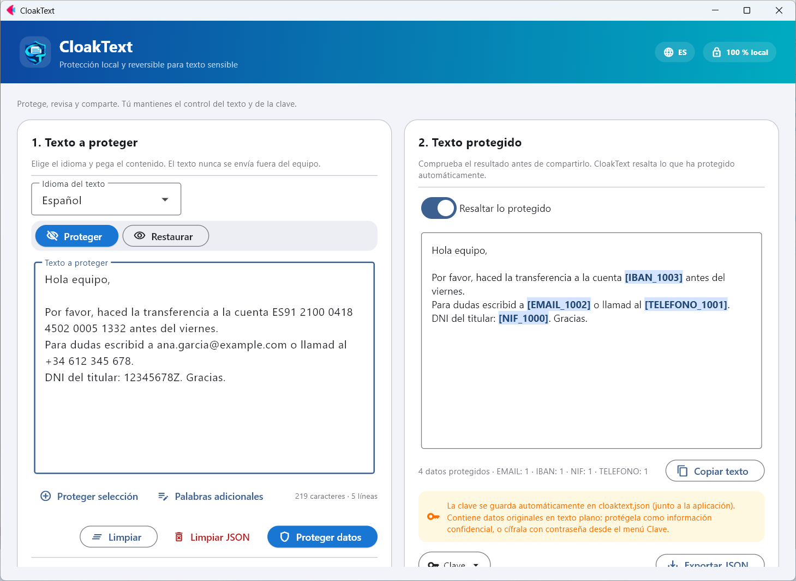
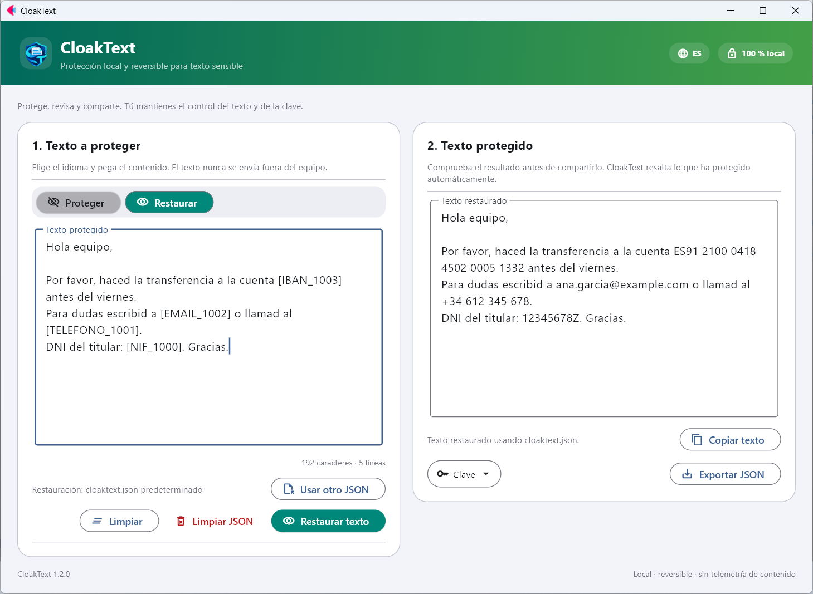

<p align="center">
  
</p>

<h1 align="center">CloakText</h1>

<p align="center">
  Protección local y reversible para texto sensible. Sin conexión y de código abierto.<br>
  <a href="README.md">English</a> · <b>Español</b> · <a href="README.fr.md">Français</a> · <a href="README.de.md">Deutsch</a> · <a href="README.it.md">Italiano</a> · <a href="README.pt.md">Português</a> · <a href="README.ca.md">Català</a>
</p>

<p align="center">
  <a href="https://github.com/nmc03/cloaktext/actions/workflows/ci.yml"></a>
  <a href="https://github.com/nmc03/cloaktext/releases/latest"></a>
  
  
  <a href="LICENSE"></a>
</p>

<p align="center">
  
</p>

CloakText sustituye los datos sensibles de un texto por marcadores reversibles como `[EMAIL_1001]` o `[PERSONA_1000]`, de modo que puedes pegar el texto en un chat, un ticket o un asistente de IA sin exponer los originales. Cuando necesites los valores reales, los restauras con tu clave local.

Todo se ejecuta en tu equipo. El texto no se envía a ninguna API ni servidor.

> [!IMPORTANT]
> La detección automática puede omitir información sensible. **Revisa siempre el resultado antes de compartirlo.** CloakText reduce la exposición accidental; no es una garantía de anonimización.

## Funciones

- **Protección reversible**: marcadores que restauras con una clave local.
- **Revisión antes de compartir**: lo protegido aparece resaltado en el resultado.
- **Palabras adicionales**: añade nombres de proyectos, clientes o apodos que siempre deben protegerse, o selecciona texto y pulsa *Proteger selección*.
- **Clave cifrada (opcional)**: protege `cloaktext.json` con contraseña (AES-256-GCM).
- **Higiene de la clave**: elimina las entradas con más de N días desde el menú *Clave*.
- **Interfaz en 7 idiomas** (español, inglés, francés, alemán, italiano, portugués y catalán), según el idioma de Windows y editable desde la cabecera.
- **Funciona sin conexión** y guarda sus datos junto a la aplicación (o en tu perfil de usuario si esa carpeta es de solo lectura).

## Cómo funciona

1. **Proteger.** Pega un texto, elige su idioma y pulsa *Proteger datos*. Emails, IBAN, teléfonos, documentos de identidad, nombres, lugares y organizaciones se sustituyen por marcadores.
2. **Compartir.** Copia el texto protegido donde lo necesites.
3. **Restaurar.** Pega de nuevo el texto protegido (o ya procesado) y pulsa *Restaurar texto*. Los marcadores vuelven a ser los valores originales.

La correspondencia entre marcadores y originales se guarda en `cloaktext.json`, junto a la aplicación (o en `%LOCALAPPDATA%\CloakText` si esa carpeta no admite escritura). Un mismo valor recibe siempre el mismo marcador, así que el texto protegido conserva su sentido.

> Los nombres de tipo de los marcadores (`PERSONA`, `TELEFONO`, `NIF`…) se mantienen en español en todos los idiomas de la interfaz para que las claves de cualquier versión sigan siendo compatibles.

<p align="center">
  
</p>

## Qué detecta

CloakText combina reglas para datos estructurados con reconocimiento de entidades de [spaCy](https://spacy.io/).

| Tipo | Ejemplos | Detector |
| --- | --- | --- |
| Email, IPv4, IBAN | `ana@example.com`, `192.168.10.4`, `ES91 2100 …` | reglas (IBAN con MOD-97 y longitud por país) |
| Teléfonos | `+34 612 345 678`, `91 123 45 67` | reglas, según idioma |
| DNI/NIE, pasaportes, identificadores fiscales, fechas de nacimiento | DNI, NIE, SSN, NINO, NIR, Codice Fiscale… | reglas, según idioma |
| Personas, lugares, organizaciones | nombres, ciudades, empresas | modelo de idioma de spaCy |
| Tus propias palabras | nombres de proyectos, clientes, apodos | coincidencia exacta que indicas (*Palabras adicionales*) |

Idiomas: español, inglés, francés, alemán, italiano, portugués y catalán.

## Descargar para Windows

Las versiones estables están en [GitHub Releases](https://github.com/nmc03/cloaktext/releases). Descarga `CloakText-<versión>-windows-x64.zip`, descomprime la carpeta **completa** y ejecuta `CloakText.exe`. Es una distribución portable `onedir`: el ejecutable debe permanecer junto al resto de su carpeta, y esa carpeta debe tener permisos de escritura porque guarda la clave y los paquetes de idioma.

### Verificar la descarga

```powershell
Get-FileHash .\CloakText-1.2.0-windows-x64.zip -Algorithm SHA256
Get-Content .\SHA256SUMS.txt
```

Los hashes deben coincidir. El ejecutable **no está firmado digitalmente** (un certificado cuesta dinero y esto es un proyecto personal), así que Windows puede mostrar «Editor desconocido» o una advertencia de SmartScreen (*Más información → Ejecutar de todas formas*). En lugar de una firma, cada versión incluye dos comprobaciones que puedes hacer tú mismo:

1. el SHA-256 de arriba;
2. una atestación de procedencia que demuestra que el ZIP lo generó el workflow de GitHub Actions de este repositorio a partir de un commit concreto:

```powershell
gh attestation verify .\CloakText-1.2.0-windows-x64.zip --repo nmc03/cloaktext
```

También puedes compilarlo tú desde el código fuente (consulta [docs/BUILDING.md](docs/BUILDING.md)).

## Primer uso: paquetes de idioma

El paquete base no incluye modelos lingüísticos de terceros. La primera vez que usas un idioma, CloakText muestra el nombre del paquete, su tamaño (unos 400–575 MB) y su licencia. Solo si aceptas, lo descarga de los releases oficiales de [`explosion/spacy-models`](https://github.com/explosion/spacy-models), verifica un SHA-256 fijado en el código y lo instala en `CloakText\models`. Después, ese idioma funciona sin conexión.

Cada protección necesita el paquete del idioma del texto: el modelo de idioma se ejecuta junto con los detectores por reglas (emails, IBAN, teléfonos, documentos…). Si falta, CloakText ofrece prepararlo antes.

## Proteger la clave con contraseña

Abre el menú **Clave** → *Proteger la clave con contraseña…*. Desde entonces la clave se guarda cifrada (AES-256-GCM, clave derivada con scrypt) y CloakText pide la contraseña al arrancar. Las copias exportadas también quedan cifradas.

> [!WARNING]
> No hay recuperación de contraseña. Si la olvidas, los textos ya protegidos no se podrán restaurar.

## Privacidad y seguridad en breve

- El texto se procesa en local y nunca se sube.
- Sin cuenta ni telemetría. El único acceso a red es la descarga del paquete de idioma que apruebas.
- `cloaktext.json` contiene tus **datos originales en texto plano**. Trátalo como el documento original y no lo publiques ni lo sincronices sin cifrar.

Detalles en [PRIVACY.md](PRIVACY.md). Para notificar una vulnerabilidad, consulta [SECURITY.md](SECURITY.md).

## Ejecutar desde el código fuente

Requiere Python 3.11–3.14 (se recomienda 3.12).

```powershell
py -3.12 -m venv .venv
.\.venv\Scripts\Activate.ps1
python -m pip install -r requirements-dev.txt
python main.py
```

```bash
python3 -m venv .venv && source .venv/bin/activate
python -m pip install -r requirements-dev.txt
python main.py
```

## Desarrollo

```bash
python -m pytest
python -m compileall -q main.py local_engine.py language_packs.py key_store.py i18n.py branding.py version.py
python -m pip check
```

```text
main.py             Interfaz de usuario (Flet)
i18n.py + locales/  Textos de la interfaz (7 idiomas)
local_engine.py     Motor de detección y protección reversible
language_packs.py   Descarga, verificación e instalación de paquetes de idioma
key_store.py        Persistencia atómica de la clave de restauración
build.py            Compilación portable para Windows
scripts/            Herramientas de desarrollo (capturas del README)
tests/              Pruebas automáticas
```

Compilar el ejecutable se describe en [docs/BUILDING.md](docs/BUILDING.md). Para contribuir, consulta [CONTRIBUTING.md](CONTRIBUTING.md); el historial está en [CHANGELOG.md](CHANGELOG.md). Las versiones siguen SemVer.

## Licencia

El código original de CloakText se publica bajo la [licencia MIT](LICENSE). Flet, spaCy y los paquetes de idioma opcionales mantienen sus propias licencias; consulta [THIRD_PARTY_NOTICES.md](THIRD_PARTY_NOTICES.md). Algunos paquetes de idioma tienen licencias más restrictivas que MIT (por ejemplo, no comercial o GPL); por eso se descargan bajo demanda y no se incluyen en el ZIP.

Copyright © 2026 Nahúm ([@nmc03](https://github.com/nmc03)).
