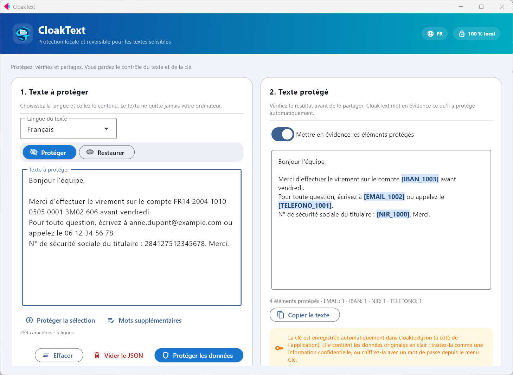
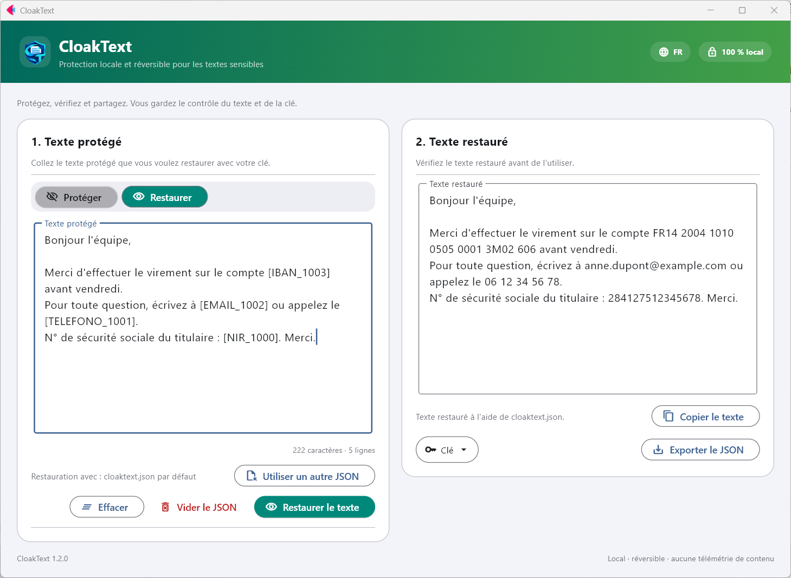

<p align="center">
  
</p>

<h1 align="center">CloakText</h1>

<p align="center">
  Protection locale et réversible pour les textes sensibles. Hors ligne et open source.<br>
  <a href="README.md">English</a> · <a href="README.es.md">Español</a> · <b>Français</b> · <a href="README.de.md">Deutsch</a> · <a href="README.it.md">Italiano</a> · <a href="README.pt.md">Português</a> · <a href="README.ca.md">Català</a>
</p>

<p align="center">
  <a href="https://github.com/nmc03/cloaktext/actions/workflows/ci.yml"></a>
  <a href="https://github.com/nmc03/cloaktext/releases/latest"></a>
  
  
  <a href="LICENSE"></a>
</p>

<p align="center">
  
</p>

CloakText remplace les données sensibles d'un texte par des marqueurs réversibles comme `[EMAIL_1001]` ou `[PERSONA_1000]`, afin que vous puissiez coller le texte dans un chat, un ticket ou un assistant IA sans exposer les originaux. Lorsque vous avez besoin des valeurs réelles, vous les restaurez avec votre clé locale.

Tout s'exécute sur votre ordinateur. Le texte n'est jamais envoyé à une API ni à un serveur.

> [!IMPORTANT]
> La détection automatique peut omettre des données sensibles. **Vérifiez toujours le résultat avant de le partager.** CloakText réduit l'exposition accidentelle ; ce n'est pas une garantie d'anonymisation.

## Fonctionnalités

- **Protection réversible** : des marqueurs que vous pouvez restaurer avec une clé locale.
- **Vérification avant partage** : les éléments protégés sont mis en évidence dans le résultat.
- **Mots supplémentaires** : ajoutez les noms de projets, de clients ou de surnoms qui doivent toujours être protégés, ou sélectionnez un texte et appuyez sur *Protéger la sélection*.
- **Clé chiffrée (facultatif)** : protégez `cloaktext.json` par un mot de passe (AES-256-GCM).
- **Hygiène de la clé** : supprimez les entrées de plus de N jours depuis le menu *Clé*.
- **Interface en 7 langues** (anglais, espagnol, français, allemand, italien, portugais et catalan), selon la langue de Windows et modifiable depuis l'en-tête.
- **Fonctionne hors ligne** et enregistre ses données à côté de l'application (ou dans votre profil utilisateur si ce dossier est en lecture seule).

## Fonctionnement

1. **Protéger.** Collez un texte, choisissez sa langue et appuyez sur *Protéger les données*. Les emails, IBAN, numéros de téléphone, numéros d'identité, noms, lieux et organisations sont remplacés par des marqueurs.
2. **Partager.** Copiez le texte protégé là où vous en avez besoin.
3. **Restaurer.** Collez à nouveau le texte protégé (ou traité) et appuyez sur *Restaurer le texte*. Les marqueurs redeviennent les valeurs d'origine.

La correspondance entre les marqueurs et les originaux est enregistrée dans `cloaktext.json`, à côté de l'application (ou dans `%LOCALAPPDATA%\CloakText` si ce dossier n'est pas accessible en écriture). Une même valeur reçoit toujours le même marqueur, afin que le texte protégé conserve son sens.

> Les noms de type des marqueurs (`PERSONA`, `TELEFONO`, `NIF`…) restent en espagnol dans toutes les langues de l'interface afin que les clés créées par n'importe quelle version restent compatibles.

<p align="center">
  
</p>

## Ce qui est détecté

CloakText combine des règles pour les données structurées et la reconnaissance d'entités nommées de [spaCy](https://spacy.io/).

| Type | Exemples | Détecteur |
| --- | --- | --- |
| Email, IPv4, IBAN | `ana@example.com`, `192.168.10.4`, `ES91 2100 …` | règles (IBAN vérifié avec MOD-97 et longueur par pays) |
| Numéros de téléphone | `+34 612 345 678`, `91 123 45 67` | règles, selon la langue |
| Numéros d'identité, passeports, identifiants fiscaux, dates de naissance | DNI, NIE, SSN, NINO, NIR, Codice Fiscale… | règles, selon la langue |
| Personnes, lieux, organisations | noms, villes, entreprises | modèle de langue spaCy |
| Vos propres mots | noms de projets, clients, surnoms | correspondance exacte que vous indiquez (*Mots supplémentaires*) |

Langues : espagnol, anglais, français, allemand, italien, portugais et catalan.

## Télécharger pour Windows

Les versions stables sont publiées sur [GitHub Releases](https://github.com/nmc03/cloaktext/releases). Téléchargez `CloakText-<version>-windows-x64.zip`, décompressez le dossier **complet** et exécutez `CloakText.exe`. C'est une distribution portable `onedir` : l'exécutable doit rester à côté du reste de son dossier, et ce dossier doit être accessible en écriture, car il stocke la clé et les paquets de langue.

### Vérifier le téléchargement

```powershell
Get-FileHash .\CloakText-1.2.3-windows-x64.zip -Algorithm SHA256
Get-Content .\SHA256SUMS.txt
```

Les empreintes doivent correspondre. L'exécutable n'est **pas signé numériquement** (un certificat coûte de l'argent et ce projet est personnel). Windows peut donc afficher « Éditeur inconnu » ou un avertissement SmartScreen (*Informations complémentaires → Exécuter quand même*). Au lieu d'une signature, chaque version comporte deux vérifications que vous pouvez faire vous-même :

1. le SHA-256 ci-dessus ;
2. une attestation de provenance qui prouve que le ZIP a été généré par le workflow GitHub Actions de ce dépôt à partir d'un commit précis :

```powershell
gh attestation verify .\CloakText-1.2.3-windows-x64.zip --repo nmc03/cloaktext
```

Vous pouvez aussi le compiler vous-même à partir du code source (voir [docs/BUILDING.md](docs/BUILDING.md)).

## Première utilisation : paquets de langue

Le paquet de base ne contient pas de modèles linguistiques tiers. La première fois que vous utilisez une langue, CloakText affiche le nom du paquet, sa taille (environ 400–575 Mo) et sa licence. Seulement si vous acceptez, il le télécharge depuis les releases officielles de [`explosion/spacy-models`](https://github.com/explosion/spacy-models), vérifie un SHA-256 fixé dans le code et l'installe dans `CloakText\models`. Ensuite, cette langue fonctionne hors ligne.

Chaque protection nécessite le paquet de langue du texte : le modèle de langue s'exécute avec les détecteurs par règles (emails, IBAN, téléphones, identifiants…). S'il manque, CloakText propose de le préparer d'abord.

## Protéger la clé par un mot de passe

Ouvrez le menu **Clé** → *Protéger la clé par un mot de passe…*. La clé est alors enregistrée chiffrée (AES-256-GCM, clé dérivée avec scrypt) et CloakText demande le mot de passe au démarrage. Les copies exportées restent également chiffrées.

> [!WARNING]
> Il n'existe aucune récupération de mot de passe. Si vous l'oubliez, les textes déjà protégés ne pourront pas être restaurés.

## Confidentialité et sécurité en bref

- Le texte est traité localement et n'est jamais envoyé.
- Pas de compte, pas de télémétrie. Le seul accès réseau est le téléchargement du paquet de langue que vous approuvez.
- `cloaktext.json` contient vos **données originales en texte brut**. Traitez-le comme le document d'origine et ne le publiez ni ne le synchronisez jamais sans chiffrement.

Détails dans [PRIVACY.md](PRIVACY.md). Pour signaler une vulnérabilité, consultez [SECURITY.md](SECURITY.md).

## Exécuter depuis le code source

Requiert Python 3.11–3.14 (3.12 recommandé).

```powershell
py -3.12 -m venv .venv
.\.venv\Scripts\Activate.ps1
python -m pip install -r requirements-dev.txt
python main.py
```

```bash
python3 -m venv .venv && source .venv/bin/activate
python -m pip install -r requirements-dev.txt
python main.py
```

## Développement

```bash
python -m pytest
python -m compileall -q main.py local_engine.py language_packs.py key_store.py i18n.py branding.py version.py
python -m pip check
```

```text
main.py             Interface utilisateur (Flet)
i18n.py + locales/  Textes de l'interface (7 langues)
local_engine.py     Moteur de détection et de protection réversible
language_packs.py   Téléchargement, vérification et installation des paquets de langue
key_store.py        Enregistrement atomique de la clé de restauration
build.py            Compilation Windows portable
scripts/            Outils de développement (captures du README)
tests/              Tests automatisés
```

La compilation de l'exécutable est décrite dans [docs/BUILDING.md](docs/BUILDING.md). Pour contribuer, consultez [CONTRIBUTING.md](CONTRIBUTING.md) ; l'historique se trouve dans [CHANGELOG.md](CHANGELOG.md). Les versions suivent le SemVer.

## Licence

Le code original de CloakText est publié sous la [licence MIT](LICENSE). Flet, spaCy et les paquets de langue optionnels conservent leurs propres licences ; voir [THIRD_PARTY_NOTICES.md](THIRD_PARTY_NOTICES.md). Certains paquets de langue ont des licences plus restrictives que la MIT (par exemple non commerciales ou GPL) ; c'est pourquoi ils sont téléchargés à la demande et non inclus dans le ZIP.

Copyright © 2026 [@nmc03](https://github.com/nmc03).
