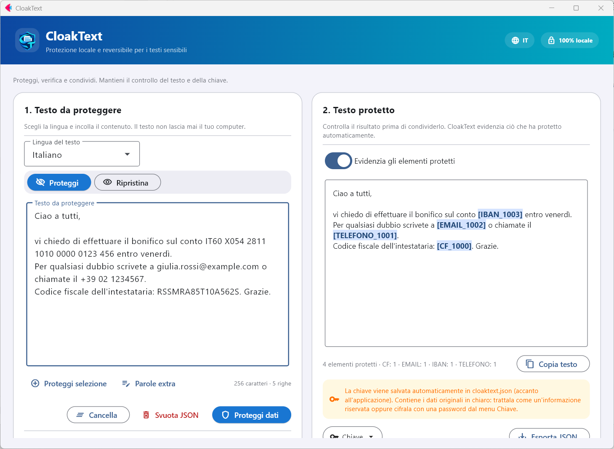
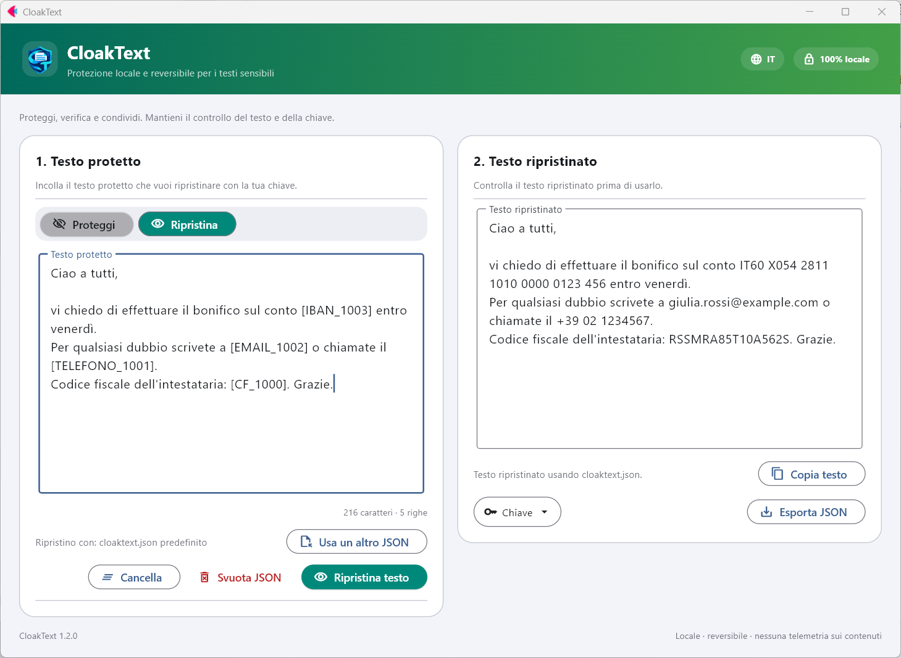

<p align="center">
  
</p>

<h1 align="center">CloakText</h1>

<p align="center">
  Protezione locale e reversibile per i testi sensibili. Offline e open source.<br>
  <a href="README.md">English</a> · <a href="README.es.md">Español</a> · <a href="README.fr.md">Français</a> · <a href="README.de.md">Deutsch</a> · <b>Italiano</b> · <a href="README.pt.md">Português</a> · <a href="README.ca.md">Català</a>
</p>

<p align="center">
  <a href="https://github.com/nmc03/cloaktext/actions/workflows/ci.yml"></a>
  <a href="https://github.com/nmc03/cloaktext/releases/latest"></a>
  
  
  <a href="LICENSE"></a>
</p>

<p align="center">
  
</p>

CloakText sostituisce i dati sensibili di un testo con segnaposto reversibili come `[EMAIL_1001]` o `[PERSONA_1000]`, così puoi incollare il testo in una chat, in un ticket o in un assistente IA senza esporre gli originali. Quando ti servono di nuovo i valori reali, li ripristini con la tua chiave locale.

Tutto viene eseguito sul tuo computer. Il testo non viene inviato a nessuna API né a nessun server.

> [!IMPORTANT]
> Il rilevamento automatico può non individuare dati sensibili. **Controlla sempre il risultato prima di condividerlo.** CloakText riduce l'esposizione accidentale; non è una garanzia di anonimizzazione.

## Funzionalità

- **Protezione reversibile**: segnaposto che puoi ripristinare con una chiave locale.
- **Verifica prima di condividere**: i dati protetti vengono evidenziati nel risultato.
- **Parole extra**: aggiungi nomi di progetti, clienti o soprannomi che devono essere sempre protetti, oppure seleziona un testo e premi *Proteggi selezione*.
- **Chiave cifrata (facoltativa)**: proteggi `cloaktext.json` con una password (AES-256-GCM).
- **Igiene della chiave**: cancella le voci più vecchie di N giorni dal menu *Chiave*.
- **Interfaccia in 7 lingue** (spagnolo, inglese, francese, tedesco, italiano, portoghese e catalano), che segue la lingua di Windows ed è modificabile dall'intestazione.
- **Funziona offline** e salva i suoi dati accanto all'applicazione (o nel tuo profilo utente se quella cartella è di sola lettura).

## Come funziona

1. **Proteggere.** Incolla un testo, scegli la sua lingua e premi *Proteggi dati*. Email, IBAN, numeri di telefono, documenti d'identità, nomi, luoghi e organizzazioni vengono sostituiti con segnaposto.
2. **Condividere.** Copia il testo protetto dove ti serve.
3. **Ripristinare.** Incolla di nuovo il testo protetto (o elaborato) e premi *Ripristina testo*. I segnaposto tornano ad essere i valori originali.

La corrispondenza tra segnaposto e originali viene salvata in `cloaktext.json`, accanto all'applicazione (o in `%LOCALAPPDATA%\CloakText` se quella cartella non è scrivibile). Uno stesso valore riceve sempre lo stesso segnaposto, quindi il testo protetto conserva il suo significato.

> I nomi dei tipi di segnaposto (`PERSONA`, `TELEFONO`, `NIF`…) restano in spagnolo in tutte le lingue dell'interfaccia, così le chiavi create da qualsiasi versione restano compatibili.

<p align="center">
  
</p>

## Cosa rileva

CloakText combina regole per i dati strutturati con il riconoscimento di entità di [spaCy](https://spacy.io/).

| Tipo | Esempi | Rilevatore |
| --- | --- | --- |
| Email, IPv4, IBAN | `ana@example.com`, `192.168.10.4`, `ES91 2100 …` | regole (IBAN verificato con MOD-97 e lunghezza per paese) |
| Numeri di telefono | `+34 612 345 678`, `91 123 45 67` | regole, per lingua |
| Documenti d'identità, passaporti, codici fiscali, date di nascita | DNI/NIE, SSN, NINO, NIR, Codice Fiscale… | regole, per lingua |
| Persone, luoghi, organizzazioni | nomi, città, aziende | modello linguistico di spaCy |
| Le tue parole | nomi di progetti, clienti, soprannomi | corrispondenza esatta che indichi (*Parole extra*) |

Lingue: spagnolo, inglese, francese, tedesco, italiano, portoghese e catalano.

## Download per Windows

Le versioni stabili sono pubblicate su [GitHub Releases](https://github.com/nmc03/cloaktext/releases). Scarica `CloakText-<versione>-windows-x64.zip`, estrai la cartella **completa** ed esegui `CloakText.exe`. È una distribuzione portatile `onedir`: l'eseguibile deve restare insieme al resto della sua cartella, che deve essere scrivibile perché vi vengono salvati la chiave e i pacchetti di lingua.

### Verificare il download

```powershell
Get-FileHash .\CloakText-1.2.2-windows-x64.zip -Algorithm SHA256
Get-Content .\SHA256SUMS.txt
```

I hash devono coincidere. L'eseguibile **non è firmato digitalmente** (un certificato costa denaro e questo è un progetto personale), quindi Windows può mostrare «Editore sconosciuto» oppure un avviso di SmartScreen (*Ulteriori informazioni → Esegui comunque*). Al posto della firma, ogni versione include due controlli che puoi eseguire tu stesso:

1. l'hash SHA-256 indicato sopra;
2. un'attestazione di provenienza che dimostra che lo ZIP è stato generato dal workflow di GitHub Actions di questo repository a partire da un commit specifico:

```powershell
gh attestation verify .\CloakText-1.2.2-windows-x64.zip --repo nmc03/cloaktext
```

Puoi anche compilarlo tu stesso dal codice sorgente (vedi [docs/BUILDING.md](docs/BUILDING.md)).

## Primo utilizzo: pacchetti di lingua

Il pacchetto base non include modelli linguistici di terze parti. La prima volta che usi una lingua, CloakText mostra il nome del pacchetto, le sue dimensioni (circa 400–575 MB) e la sua licenza. Solo se accetti, lo scarica dalle release ufficiali di [`explosion/spacy-models`](https://github.com/explosion/spacy-models), verifica un SHA-256 fissato nel codice e lo installa in `CloakText\models`. Dopodiché quella lingua funziona offline.

Ogni protezione richiede il pacchetto della lingua del testo: il modello linguistico viene eseguito insieme ai rilevatori basati su regole (email, IBAN, telefoni, documenti…). Se manca, CloakText propone di prepararlo prima.

## Proteggere la chiave con una password

Apri il menu **Chiave** → *Proteggi la chiave con una password…*. Da quel momento la chiave viene salvata cifrata (AES-256-GCM, chiave derivata con scrypt) e CloakText chiede la password all'avvio. Anche le copie esportate restano cifrate.

> [!WARNING]
> Non esiste un recupero della password. Se la dimentichi, i testi già protetti non potranno più essere ripristinati.

## Privacy e sicurezza in breve

- Il testo viene elaborato in locale e non viene mai caricato.
- Nessun account, nessuna telemetria. L'unico accesso alla rete è il download del pacchetto di lingua che approvi.
- `cloaktext.json` contiene i tuoi **dati originali in chiaro**. Trattalo come il documento originale e non pubblicarlo né sincronizzarlo senza cifratura.

Dettagli in [PRIVACY.md](PRIVACY.md). Per segnalare una vulnerabilità, consulta [SECURITY.md](SECURITY.md).

## Eseguire dal codice sorgente

Richiede Python 3.11–3.14 (si consiglia 3.12).

```powershell
py -3.12 -m venv .venv
.\.venv\Scripts\Activate.ps1
python -m pip install -r requirements-dev.txt
python main.py
```

```bash
python3 -m venv .venv && source .venv/bin/activate
python -m pip install -r requirements-dev.txt
python main.py
```

## Sviluppo

```bash
python -m pytest
python -m compileall -q main.py local_engine.py language_packs.py key_store.py i18n.py branding.py version.py
python -m pip check
```

```text
main.py             Interfaccia utente Flet
i18n.py + locales/  Testi dell'interfaccia (7 lingue)
local_engine.py     Motore di rilevamento e protezione reversibile
language_packs.py   Download, verifica e installazione dei pacchetti di lingua
key_store.py        Salvataggio atomico della chiave di ripristino
build.py            Build portatile per Windows
scripts/            Strumenti per sviluppatori (screenshot del README)
tests/              Test automatici
```

La compilazione dell'eseguibile è descritta in [docs/BUILDING.md](docs/BUILDING.md). Per contribuire, consulta [CONTRIBUTING.md](CONTRIBUTING.md); la cronologia è in [CHANGELOG.md](CHANGELOG.md). Le versioni seguono il SemVer.

## Licenza

Il codice originale di CloakText è pubblicato con la [licenza MIT](LICENSE). Flet, spaCy e i pacchetti di lingua facoltativi mantengono le proprie licenze; consulta [THIRD_PARTY_NOTICES.md](THIRD_PARTY_NOTICES.md). Alcuni pacchetti di lingua hanno licenze più restrittive della MIT (per esempio non commerciali o GPL); per questo vengono scaricati su richiesta e non sono inclusi nel pacchetto.

Copyright © 2026 [@nmc03](https://github.com/nmc03).
