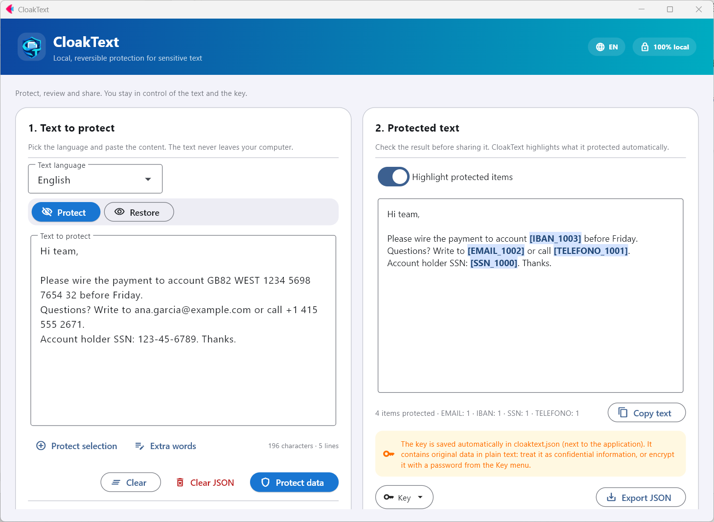
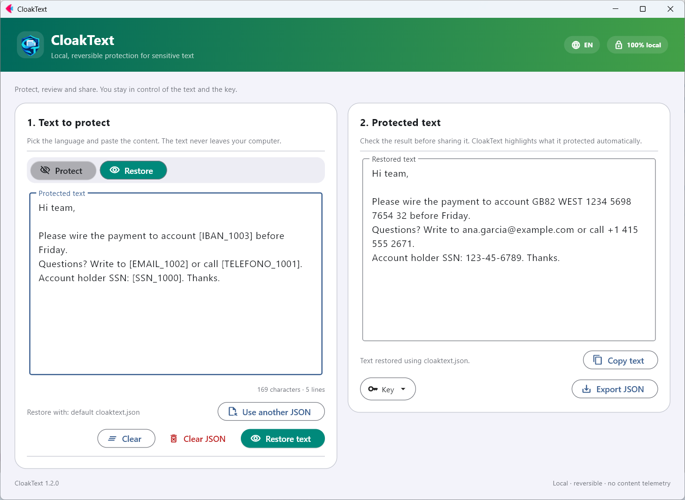

<p align="center">
  
</p>

<h1 align="center">CloakText</h1>

<p align="center">
  Local, reversible protection for sensitive text. Offline and open source.<br>
  <b>English</b> · <a href="README.es.md">Español</a> · <a href="README.fr.md">Français</a> · <a href="README.de.md">Deutsch</a> · <a href="README.it.md">Italiano</a> · <a href="README.pt.md">Português</a> · <a href="README.ca.md">Català</a>
</p>

<p align="center">
  <a href="https://github.com/nmc03/cloaktext/actions/workflows/ci.yml"></a>
  <a href="https://github.com/nmc03/cloaktext/releases/latest"></a>
  
  
  <a href="LICENSE"></a>
</p>

<p align="center">
  
</p>

CloakText replaces sensitive data in a text with reversible placeholders such as `[EMAIL_1001]` or `[PERSONA_1000]`, so you can paste the text into a chat, a ticket or an AI assistant without exposing the originals. When you need the real values back, restore them with your local key.

Everything runs on your computer. The text is never sent to an API or a server.

> [!IMPORTANT]
> Automatic detection can miss sensitive data. **Always review the result before sharing it.** CloakText reduces accidental exposure; it is not an anonymisation guarantee.

## Features

- **Reversible protection**: placeholders you can restore with a local key.
- **Review before sharing**: protected items are highlighted in the result.
- **Extra words**: add project names, clients or nicknames that must always be protected, or select text and press *Protect selection*.
- **Encrypted key (optional)**: protect `cloaktext.json` with a password (AES-256-GCM).
- **Key hygiene**: clear entries older than N days from the *Key* menu.
- **Interface in 7 languages** (English, Spanish, French, German, Italian, Portuguese, Catalan), following your Windows language and switchable from the header.
- **Works offline** and writes its data next to the app (or to your user profile if that folder is read-only).

## How it works

1. **Protect.** Paste a text, pick its language and press *Protect data*. Emails, IBANs, phone numbers, ID numbers, names, places and organisations are replaced by placeholders.
2. **Share.** Copy the protected text wherever you need it.
3. **Restore.** Paste the protected (or processed) text back and press *Restore text*. The placeholders become the original values again.

The mapping between placeholders and originals is saved in `cloaktext.json`, next to the application (or in `%LOCALAPPDATA%\CloakText` if the application folder is not writable). The same value always gets the same placeholder, so the protected text keeps its meaning.

> Placeholder type names (`PERSONA`, `TELEFONO`, `NIF`…) stay in Spanish in every interface language so that keys created by any version remain compatible.

<p align="center">
  
</p>

## What it detects

CloakText combines rule-based detectors for structured data with named-entity recognition from [spaCy](https://spacy.io/).

| Kind | Examples | Detector |
| --- | --- | --- |
| Email, IPv4, IBAN | `ana@example.com`, `192.168.10.4`, `ES91 2100 …` | rules (IBAN checked with MOD-97 and per-country length) |
| Phone numbers | `+34 612 345 678`, `91 123 45 67` | rules, per language |
| ID numbers, passports, tax IDs, birth dates | DNI/NIE, SSN, NINO, NIR, Codice Fiscale… | rules, per language |
| People, places, organisations | names, cities, companies | spaCy language model |
| Your own words | project names, clients, nicknames | exact match you provide (*Extra words*) |

Languages: Spanish, English, French, German, Italian, Portuguese and Catalan.

## Download (Windows)

Stable versions are published on [GitHub Releases](https://github.com/nmc03/cloaktext/releases). Download `CloakText-<version>-windows-x64.zip`, extract the **whole** folder and run `CloakText.exe`. Keep the executable next to the rest of its folder; it is a portable `onedir` build. The folder must be writable, because the key file and the language packs are stored inside it.

### Verify the download

```powershell
Get-FileHash .\CloakText-1.2.0-windows-x64.zip -Algorithm SHA256
Get-Content .\SHA256SUMS.txt
```

The hashes must match. The executable is **not code-signed** (a certificate costs money and this is a hobby project), so Windows may show "Unknown publisher" or a SmartScreen warning (*More info → Run anyway*). Instead of a signature, every release carries two checks you can run yourself:

1. the SHA-256 above;
2. a build-provenance attestation that proves the ZIP was built by this repository's GitHub Actions workflow from a specific commit:

```powershell
gh attestation verify .\CloakText-1.2.0-windows-x64.zip --repo nmc03/cloaktext
```

You can also build it yourself from source (see [docs/BUILDING.md](docs/BUILDING.md)).

## First use: language packs

The base package does not ship third-party language models. The first time you use a language, CloakText shows the package name, its size (about 400–575 MB) and its license. Only if you accept, it downloads the package from the official [`explosion/spacy-models`](https://github.com/explosion/spacy-models) releases, verifies a SHA-256 pinned in the code, and installs it in `CloakText\models`. Afterwards that language works offline.

Every protection run needs the language pack for the text's language: the language model runs together with the rule-based detectors (emails, IBANs, phones, IDs…). If it is missing, CloakText offers to prepare it first.

## Protecting the key with a password

Open the **Key** menu → *Protect the key with a password…*. The key is then stored encrypted (AES-256-GCM, key derived with scrypt) and CloakText asks for the password when it starts. Exported copies stay encrypted too.

> [!WARNING]
> There is no password recovery. If you forget it, texts already protected cannot be restored.

## Privacy and security in short

- Text is processed locally and never uploaded.
- No account, no telemetry. The only network access is the language-pack download you approve.
- `cloaktext.json` contains your **original data in plain text**. Treat it like the original document and never publish or sync it unencrypted.

Details in [PRIVACY.md](PRIVACY.md). To report a vulnerability, see [SECURITY.md](SECURITY.md).

## Run from source

Requires Python 3.11–3.14 (3.12 recommended).

```powershell
py -3.12 -m venv .venv
.\.venv\Scripts\Activate.ps1
python -m pip install -r requirements-dev.txt
python main.py
```

```bash
python3 -m venv .venv && source .venv/bin/activate
python -m pip install -r requirements-dev.txt
python main.py
```

## Development

```bash
python -m pytest
python -m compileall -q main.py local_engine.py language_packs.py key_store.py i18n.py branding.py version.py
python -m pip check
```

```text
main.py             Flet user interface
i18n.py + locales/  Interface strings (7 languages)
local_engine.py     Detection and reversible protection engine
language_packs.py   Download, verification and installation of language packs
key_store.py        Atomic persistence of the restore key
build.py            Portable Windows build
scripts/            Developer tools (README screenshots)
tests/              Automated tests
```

Building the Windows executable is described in [docs/BUILDING.md](docs/BUILDING.md). See [CONTRIBUTING.md](CONTRIBUTING.md) to contribute and [CHANGELOG.md](CHANGELOG.md) for the history. Releases follow semantic versioning.

## License

The original CloakText code is released under the [MIT License](LICENSE). Flet, spaCy and the optional language packs keep their own licenses; see [THIRD_PARTY_NOTICES.md](THIRD_PARTY_NOTICES.md). Some language packs carry licenses that are stricter than MIT (for example non-commercial or GPL terms); that is why they are downloaded on demand and not bundled.

Copyright © 2026 Nahúm ([@nmc03](https://github.com/nmc03)).
