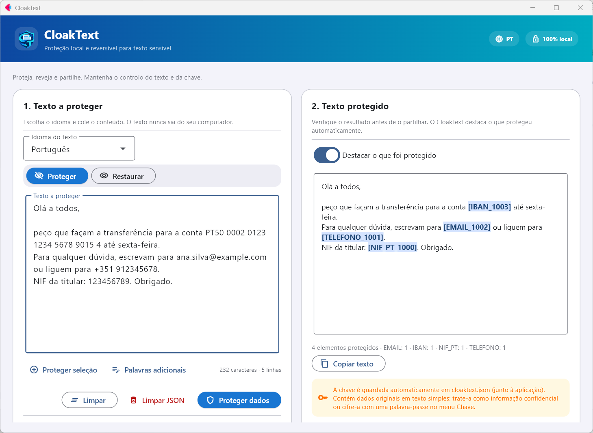
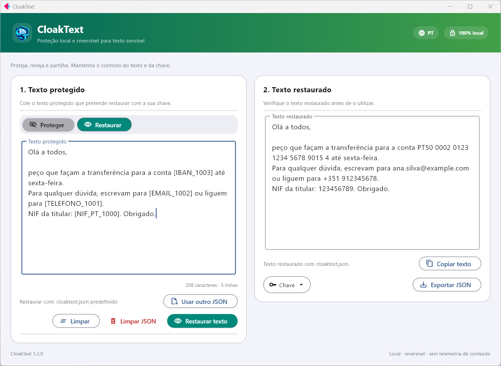

<p align="center">
  
</p>

<h1 align="center">CloakText</h1>

<p align="center">
  Proteção local e reversível para texto sensível. Sem ligação à Internet e de código aberto.<br>
  <a href="README.md">English</a> · <a href="README.es.md">Español</a> · <a href="README.fr.md">Français</a> · <a href="README.de.md">Deutsch</a> · <a href="README.it.md">Italiano</a> · <b>Português</b> · <a href="README.ca.md">Català</a>
</p>

<p align="center">
  <a href="https://github.com/nmc03/cloaktext/actions/workflows/ci.yml"></a>
  <a href="https://github.com/nmc03/cloaktext/releases/latest"></a>
  
  
  <a href="LICENSE"></a>
</p>

<p align="center">
  
</p>

O CloakText substitui os dados sensíveis de um texto por marcadores reversíveis, como `[EMAIL_1001]` ou `[PERSONA_1000]`, para que possa colar o texto num chat, num pedido de suporte ou num assistente de IA sem expor os originais. Quando precisar dos valores reais, restaure-os com a sua chave local.

Tudo é executado no seu computador. O texto nunca é enviado para uma API ou para um servidor.

> [!IMPORTANT]
> A deteção automática pode não identificar dados sensíveis. **Reveja sempre o resultado antes de o partilhar.** O CloakText reduz a exposição acidental; não é uma garantia de anonimização.

## Funcionalidades

- **Proteção reversível**: marcadores que pode restaurar com uma chave local.
- **Revisão antes de partilhar**: os itens protegidos ficam destacados no resultado.
- **Palavras adicionais**: acrescente nomes de projetos, clientes ou alcunhas que devem estar sempre protegidos, ou selecione um texto e prima *Proteger seleção*.
- **Chave cifrada (opcional)**: proteja o `cloaktext.json` com uma palavra-passe (AES-256-GCM).
- **Higiene da chave**: limpe as entradas com mais de N dias no menu *Chave*.
- **Interface em 7 idiomas** (inglês, espanhol, francês, alemão, italiano, português e catalão), segundo o idioma do Windows, e alterável no cabeçalho.
- **Funciona sem ligação à Internet** e guarda os dados junto da aplicação (ou no seu perfil de utilizador, se essa pasta for só de leitura).

## Como funciona

1. **Proteger.** Cole um texto, escolha o seu idioma e prima *Proteger dados*. Emails, IBAN, números de telefone, números de identificação, nomes, locais e organizações são substituídos por marcadores.
2. **Partilhar.** Copie o texto protegido para onde precisar.
3. **Restaurar.** Cole de novo o texto protegido (ou já processado) e prima *Restaurar texto*. Os marcadores voltam a ser os valores originais.

A correspondência entre marcadores e originais é guardada no `cloaktext.json`, junto da aplicação (ou em `%LOCALAPPDATA%\CloakText` se a pasta da aplicação não permitir escrita). O mesmo valor recebe sempre o mesmo marcador, para que o texto protegido mantenha o seu sentido.

> Os nomes dos tipos de marcadores (`PERSONA`, `TELEFONO`, `NIF`…) mantêm-se em espanhol em todos os idiomas da interface, para que as chaves criadas por qualquer versão continuem compatíveis.

<p align="center">
  
</p>

## O que deteta

O CloakText combina regras para dados estruturados com o reconhecimento de entidades do [spaCy](https://spacy.io/).

| Tipo | Exemplos | Detetor |
| --- | --- | --- |
| Email, IPv4, IBAN | `ana@example.com`, `192.168.10.4`, `ES91 2100 …` | regras (IBAN verificado com MOD-97 e comprimento por país) |
| Números de telefone | `+34 612 345 678`, `91 123 45 67` | regras, por idioma |
| Números de identificação, passaportes, números fiscais, datas de nascimento | DNI/NIE, SSN, NINO, NIR, Codice Fiscale… | regras, por idioma |
| Pessoas, locais, organizações | nomes, cidades, empresas | modelo linguístico do spaCy |
| As suas próprias palavras | nomes de projetos, clientes, alcunhas | correspondência exata que indica (*Palavras adicionais*) |

Idiomas: espanhol, inglês, francês, alemão, italiano, português e catalão.

## Transferir para Windows

As versões estáveis estão publicadas nas [GitHub Releases](https://github.com/nmc03/cloaktext/releases). Transfira `CloakText-<versão>-windows-x64.zip`, extraia a pasta **completa** e execute `CloakText.exe`. É uma distribuição portátil `onedir`: o executável deve permanecer junto ao resto da sua pasta, e essa pasta tem de ter permissão de escrita, porque guarda a chave e os pacotes de idioma.

### Verificar a transferência

```powershell
Get-FileHash .\CloakText-1.2.2-windows-x64.zip -Algorithm SHA256
Get-Content .\SHA256SUMS.txt
```

Os hashes devem coincidir. O executável **não tem assinatura digital** (um certificado tem custos e isto é um projeto pessoal), por isso o Windows pode mostrar «Editor desconhecido» ou um aviso do SmartScreen (*Mais informações → Executar mesmo assim*). Em vez de uma assinatura, cada versão inclui duas verificações que pode fazer por si:

1. o SHA-256 indicado acima;
2. uma atestação de proveniência que demonstra que o ZIP foi gerado pelo workflow do GitHub Actions deste repositório a partir de um commit concreto:

```powershell
gh attestation verify .\CloakText-1.2.2-windows-x64.zip --repo nmc03/cloaktext
```

Também pode compilá-lo a partir do código-fonte (consulte [docs/BUILDING.md](docs/BUILDING.md)).

## Primeira utilização: pacotes de idioma

O pacote base não inclui modelos linguísticos de terceiros. Na primeira vez que usar um idioma, o CloakText mostra o nome do pacote, o seu tamanho (cerca de 400–575 MB) e a sua licença. Só se aceitar, transfere o pacote das versões oficiais do [`explosion/spacy-models`](https://github.com/explosion/spacy-models), verifica um SHA-256 fixado no código e instala-o em `CloakText\models`. Depois disso, esse idioma funciona sem ligação à Internet.

Cada proteção requer o pacote do idioma do texto: o modelo linguístico é executado em conjunto com os detetores por regras (emails, IBAN, telefones, documentos…). Se faltar, o CloakText propõe prepará-lo primeiro.

## Proteger a chave com palavra-passe

Abra o menu **Chave** → *Proteger a chave com palavra-passe…*. A partir daí, a chave fica guardada cifrada (AES-256-GCM, com chave derivada através de scrypt) e o CloakText pede a palavra-passe ao arrancar. As cópias exportadas também ficam cifradas.

> [!WARNING]
> Não existe recuperação de palavra-passe. Se a esquecer, os textos já protegidos não poderão ser restaurados.

## Privacidade e segurança em resumo

- O texto é processado localmente e nunca é enviado para lado nenhum.
- Sem conta e sem telemetria. O único acesso à rede é a transferência do pacote de idioma que aprovar.
- O `cloaktext.json` contém os seus **dados originais em texto simples**. Trate-o como o documento original e nunca o publique nem o sincronize sem cifra.

Detalhes em [PRIVACY.md](PRIVACY.md). Para comunicar uma vulnerabilidade, consulte [SECURITY.md](SECURITY.md).

## Executar a partir do código-fonte

Requer Python 3.11–3.14 (recomenda-se 3.12).

```powershell
py -3.12 -m venv .venv
.\.venv\Scripts\Activate.ps1
python -m pip install -r requirements-dev.txt
python main.py
```

```bash
python3 -m venv .venv && source .venv/bin/activate
python -m pip install -r requirements-dev.txt
python main.py
```

## Desenvolvimento

```bash
python -m pytest
python -m compileall -q main.py local_engine.py language_packs.py key_store.py i18n.py branding.py version.py
python -m pip check
```

```text
main.py             Interface gráfica em Flet
i18n.py + locales/  Textos da interface (7 idiomas)
local_engine.py     Motor de deteção e proteção reversível
language_packs.py   Transferência, verificação e instalação dos pacotes de idioma
key_store.py        Persistência atómica da chave de restauro
build.py            Compilação portátil para Windows
scripts/            Ferramentas para programadores (capturas do README)
tests/              Testes automatizados
```

A compilação do executável para Windows está descrita em [docs/BUILDING.md](docs/BUILDING.md). Para contribuir, consulte [CONTRIBUTING.md](CONTRIBUTING.md); o histórico está em [CHANGELOG.md](CHANGELOG.md). As versões seguem o SemVer.

## Licença

O código original do CloakText é publicado sob a [licença MIT](LICENSE). O Flet, o spaCy e os pacotes de idioma opcionais mantêm as suas próprias licenças; consulte [THIRD_PARTY_NOTICES.md](THIRD_PARTY_NOTICES.md). Alguns pacotes de idioma têm licenças mais restritivas do que a MIT (por exemplo, uso não comercial ou GPL); por isso são transferidos sob pedido e não vêm incluídos no pacote.

Copyright © 2026 [@nmc03](https://github.com/nmc03).
